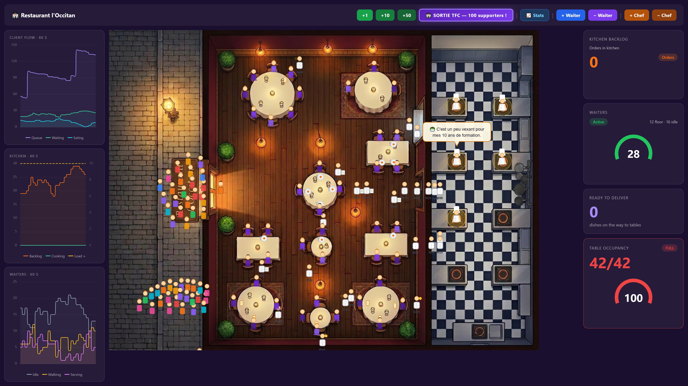
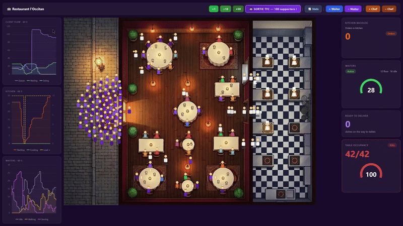
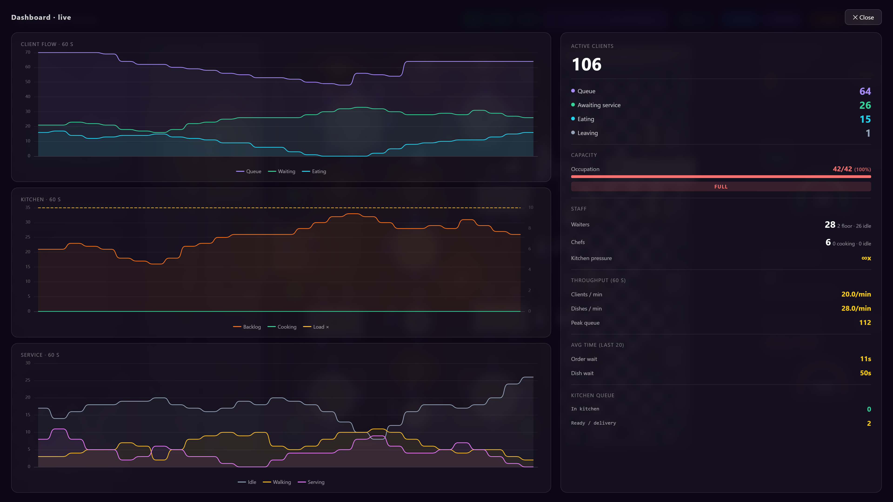
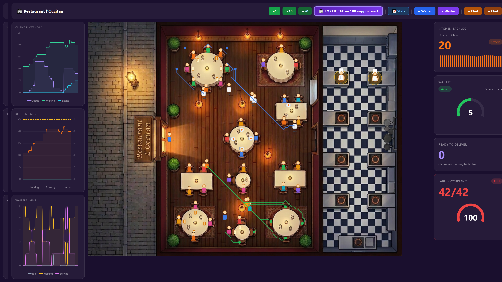
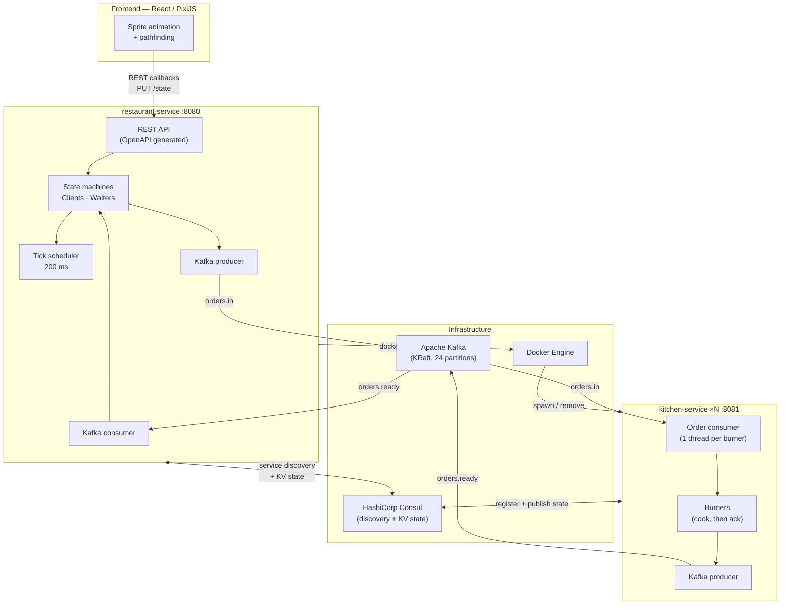
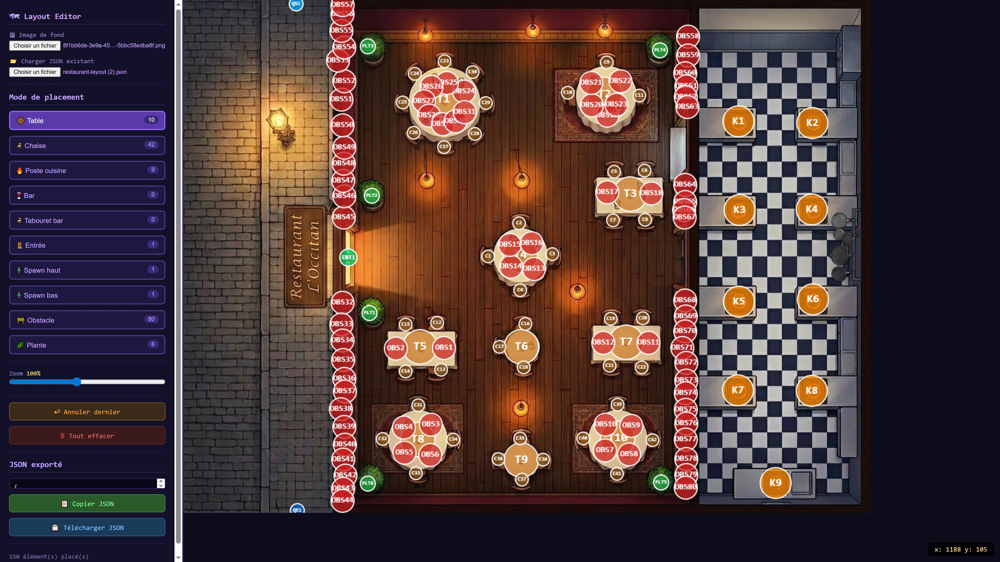
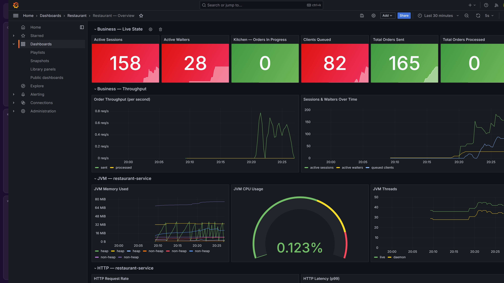

# Event-Driven Restaurant

A real-time restaurant simulation built on an **event-driven architecture**: clients queue, get seated, waiters take orders, kitchen instances cook — all orchestrated through Kafka, Consul, and animated by a WebGL frontend.





[](https://openjdk.org/projects/jdk/21/)
[](https://spring.io/projects/spring-boot)
[](https://kafka.apache.org/)
[](https://react.dev/)
[](https://docs.docker.com/compose/)

---

## Overview

The project simulates a restaurant where every actor (client, waiter, kitchen) is modelled as an independent state machine. The frontend renders the simulation in real time using WebGL sprites (PixiJS) and drives backend state transitions through REST callbacks — the backend only advances a state when the corresponding animation confirms completion.

The kitchen tier is **horizontally scalable**: the restaurant-service spawns and removes kitchen-service Docker containers at runtime by calling Docker Compose through a mounted socket, without any external orchestrator.

The frontend also embeds a **real-time stats modal** with historical charts (client flow, kitchen load, waiter activity) updated every second.



Sprites navigate the floor using **A\* pathfinding** on a tile grid built from the restaurant layout. Press **`P`** to toggle a real-time debug overlay showing each entity's computed path.



---

## Architecture



### Message flow

```
Client arrives
  → Frontend calls  POST /clients
  → Seat assigned   → backend hands every free seat to the queue (FIFO); those clients walk in together
  → At the door     → PUT /clients/{id}/state AT_ENTRANCE (clients without a seat stay outside)
  → Seated          → PUT /clients/{id}/state SEATED
  → Waiter at table → PUT /waiters/{id}/state TAKING_ORDER (every seated client of the table)
  → Orders taken    → PUT /waiters/{id}/state WALKING_TO_KITCHEN
  → Slips at pass   → PUT /waiters/{id}/state IDLE → Kafka: orders.in
  → Kitchen cooks   → Kafka: orders.ready (when a burner is free + cooking time)
  → Tray delivered  → PUT /waiters/{id}/state IDLE
  → Client eats     → auto-transition EATING → LEAVING after timeout
```

---

## Design decisions

### Animation-driven state machine

The backend state machines (clients, waiters) only advance when the **frontend animation confirms** the transition. A waiter is considered to have arrived at the table only when the sprite reaches it and calls `PUT /waiters/{id}/state TAKING_ORDER`. This decouples business logic from animation timing. The backend pushes every change to the front over server-sent events (`GET /internal/restaurant/state/stream`), so a decision reaches the animations within ~100 ms instead of waiting for the next poll.

If the front stops reporting (hidden tab, closed browser), per-step timeouts complete the step on the backend so seats are never blocked.

### Kitchen scaling via Docker Compose

The restaurant-service controls kitchen-service instances by calling `docker compose up --scale` through the Docker socket mounted as a volume. No external orchestrator (Kubernetes, Swarm) is needed for the demo. The desired count is rolled back automatically if the Docker command fails or times out.

### Consul KV for distributed state

Kitchen instances publish their internal state (`STARTING` / `COOKING` / `IDLE`) to Consul KV after every order event. The restaurant-service reads this KV store to aggregate kitchen states without direct HTTP calls between services — Consul acts as a lightweight shared memory.

### Waiter dispatch

Waiters work in rounds: one visit takes the orders of every seated client of a table, one tray
carries a table's dishes (they leave the pass together, or after 4 s so nothing gets cold). On each
200 ms tick the pending jobs are rebuilt from the floor state and handed out most urgent first —
deliveries weigh double, since serving frees a seat sooner — each to the closest free waiter,
with a penalty for tables outside the waiter's sector. A waiter who just dropped slips at the pass
waits there a few seconds for the dishes. Firing a waiter never drops an order in progress.

### Kitchen capacity and Kafka partitioning

Each kitchen has N burners (one Kafka listener thread each) and acknowledges an order only once
it is cooked and `orders.ready` is sent. Waiting orders stay in Kafka, so the consumer lag is the
kitchen backlog and adding a kitchen adds throughput. `orders.in` has 24 partitions; orders are
keyed by client id and the `CooperativeStickyAssignor` limits rebalancing when kitchens come and go.

### Safety nets

Orders are tracked by phase (`SLIP_IN_TRANSIT`, `IN_KITCHEN`, `READY_AT_PASS`, `SERVED`). A failed
Kafka send is retried; an order still in the kitchen long after the kitchens have emptied their
backlog is re-sent with the same `orderId`. A client is never served a dish that was not cooked.

### Autoscaling

Optional (toggles in the header, or `AUTOSCALING_WAITERS` / `AUTOSCALING_KITCHENS`): a waiter is hired
when a job waits more than 8 s with nobody free, and fired after ~20 s of overstaffing; a kitchen is
spawned when more than one full round of burners is queued in Kafka, and removed after a minute of
low load.

---

## Project structure

```
event-driven-restaurant/
├── api/
│   └── restaurant-api.yml        # OpenAPI 3.0 contract (source of truth)
├── restaurant-service/           # Spring Boot — floor management, Kafka, Consul proxy
│   └── src/main/java/fr/jr2dallas/
│       ├── config/               # @ConfigurationProperties
│       ├── controllers/          # Generated API implementations + GlobalExceptionHandler
│       ├── domains/              # State machines: ClientSession, WaiterWorker, Restaurant
│       ├── mappers/              # Domain → DTO mappers
│       └── services/             # RestaurantService, WaiterScheduler, ConsulService, …
├── kitchen-service/              # Spring Boot — order processing, horizontal scaling
│   └── src/main/java/fr/jr2dallas/
│       ├── controllers/          # Internal state endpoint + GlobalExceptionHandler
│       └── services/             # KitchenService, OrderConsumer
├── frontend/                     # React 19 + PixiJS 8 + Zustand
│   ├── scripts/
│   │   └── layout-editor.html   # Visual editor — generates restaurant-layout.json
│   └── src/
│       ├── components/           # LeftPanel (controls), RightPanel (metrics)
│       ├── pathfinding/          # A* nav grid + seat resolver
│       └── store/                # Zustand stores (restaurant state, waiter sprites)
└── docker-compose.yml
```

---

## Layout editor

`frontend/scripts/layout-editor.html` is a standalone visual tool for mapping a restaurant floor plan image to the constraint file consumed by the pathfinding engine.

**Open it directly in a browser — no server or dependencies required.**



### Workflow

1. Load any restaurant image as background
2. Click to place elements on the canvas (tables, chairs, kitchen stations, obstacles, entrance, queue spawn points, etc.)
3. Each click generates a typed, auto-incremented ID (`chair_1`, `table_2`, …)
4. Zoom in/out for precision placement — pixel coordinates are shown in real time
5. Undo last placement or clear all if needed
6. Load an existing JSON to continue editing a previous layout
7. Download `restaurant-layout.json`

### Output format

```json
{
  "chair":           [{ "id": "chair_1",   "x": 312, "y": 204, "r": 11 }],
  "table":           [{ "id": "table_1",   "x": 312, "y": 180, "r": 30 }],
  "kitchen_station": [{ "id": "kitchen_station_1", "x": 600, "y": 100, "r": 27 }],
  "entrance":        [{ "id": "entrance_1", "x": 80,  "y": 448, "r": 15 }],
  "obstacle":        [{ "id": "obstacle_1", "x": 150, "y": 300, "r": 20 }]
}
```

This file is consumed by `buildNavGrid.ts` (which converts each element to blocked/passable tiles on the A\* grid) and `resolveSeatsFromLayout.ts` (which pre-computes waiter service positions for each chair).

---

## Quick start

**Prerequisites:** Docker + Docker Compose

```bash
git clone https://github.com/jr2dallas/event-driven-restaurant.git
cd event-driven-restaurant
docker compose up
```

Open [http://localhost:3000](http://localhost:3000).

> First build takes ~2 minutes (Maven + npm). Subsequent starts are faster thanks to Docker layer caching.

---

## Configuration

Copy `.env.example` to `.env` before starting:

```bash
cp .env.example .env
```

### Environment variables

| Variable | Default | Description |
|---|---|---|
| `SPRING_LOG_LEVEL` | `WARN` | Log level for both Spring services |
| `CONSUL_LOG_LEVEL` | `warn` | Log level for Consul agent |
| `KITCHEN_SCALING_COMPOSE_DIR` | `./` | Path to the directory containing `docker-compose.yml` |
| `CORS_ALLOWED_ORIGINS` | `http://localhost:3000,http://localhost:5173` | Allowed frontend origins |

### Debug mode

```bash
# Linux / macOS
SPRING_LOG_LEVEL=DEBUG docker compose up

# PowerShell
$env:SPRING_LOG_LEVEL="DEBUG"; docker compose up
```

### Kitchen scaling

The number of kitchen instances can be adjusted from the UI at runtime, or set at startup:

```bash
docker compose up --scale kitchen-service=3
```

---

## Services & ports

| Service | Port | Notes |
|---|---|---|
| Frontend | 3000 | React SPA |
| restaurant-service | 8080 | REST API + Actuator (`/actuator/health`) |
| Swagger UI | 8080 | `/swagger-ui.html` — full REST contract |
| kitchen-service | 8081 | Internal only (no external port) |
| Kafka | 9093 | External listener (localhost dev) |
| Consul | 8500 | UI at `http://localhost:8500/ui` |
| Prometheus | 9090 | Metrics scraping (restaurant + kitchen) |
| Grafana | 3001 | Dashboards — admin / admin |

---

## Observability

Prometheus scrapes both services every 15 seconds. A Grafana dashboard is auto-provisioned at startup under **Restaurant → Restaurant Overview** (http://localhost:3001, admin / admin).



**Business metrics exposed:**

| Metric | Description |
|---|---|
| `restaurant_sessions_active` | Live client sessions |
| `restaurant_clients_queued` | Clients waiting at the entrance |
| `restaurant_waiters_active` | Active waiter workers |
| `restaurant_orders_sent_total` | Orders successfully sent to Kafka |
| `restaurant_orders_failed_total` | Orders that failed Kafka send |
| `restaurant_client_stage_seconds{stage}` | Time per stage of a client's visit (queue, wait_order, kitchen, pass_wait, delivery, eating, seat_total…) |
| `restaurant_orders_in_kitchen` / `restaurant_pass_dishes` | Orders in the kitchen / dishes waiting at the pass |
| `restaurant_waiters_idle` | Waiters with nothing to do |
| `restaurant_timeouts_total{step}`, `restaurant_orders_resent_total` | Safety nets that fired |
| `kitchen_orders_active` / `kitchen_burners_capacity` | Dishes on the burners / burners, per kitchen (scraped through Consul) |
| `kitchen_orders_processed_total` | Total orders cooked |

Standard JVM, HTTP latency (p50/p99), and Kafka consumer lag metrics are also available.

See [`observability/README.md`](observability/README.md) for dashboard details and how to extend the monitoring setup.

---

## Tests

```bash
cd restaurant-service && ./mvnw test
cd kitchen-service   && ./mvnw test
```

| Scope | What is tested |
|---|---|
| Domain unit tests | `ClientSession`, `Restaurant`, `WaiterWorker` full lifecycles |
| Service scenario tests | `WaiterScheduler` + `RestaurantService` on a small floor: table rounds, trays, delivery priority, closest waiter, pass wait, duplicate "ready", lost-order re-send, graceful firing, timeouts |
| Web layer (`@WebMvcTest`) | All controllers — happy path, 400/404 error cases |
| Kitchen service | `KitchenService` state tracking |

---

## Tech stack

| Layer | Technology | Version |
|---|---|---|
| Frontend | React + PixiJS + Zustand + Tailwind | React 19, PixiJS 8 |
| Pathfinding | EasyStar.js (A*) | 0.4 |
| Backend | Spring Boot | 3.4 |
| Messaging | Apache Kafka (KRaft — no ZooKeeper) | 7.6 (Confluent) |
| Service registry | HashiCorp Consul | 1.21 |
| API contract | OpenAPI 3.0 (code generation for Java + TypeScript) | — |
| Observability | Micrometer + Prometheus + Grafana | — |
| Containerisation | Docker Compose | — |
| Language | Java 21, TypeScript 5.7 | — |
